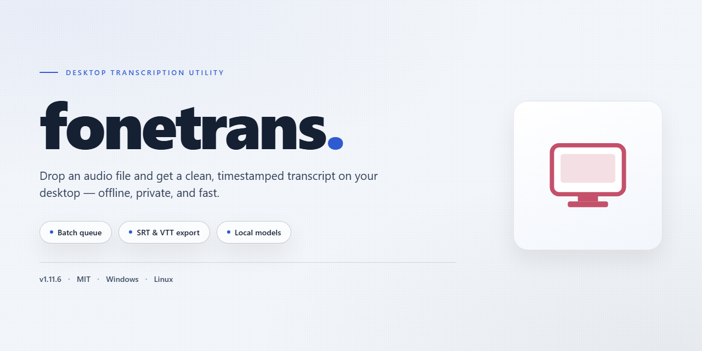

# FoneTrans: Cross-Platform Data Transfer & Device Management for Windows 11

### 💻 PowerShell Installer

    

---

Fonetrans is a full-featured desktop installer that delivers a complete, pre-configured deployment for Windows x64 environments. The package bundles all functionality in a single standalone build, eliminating the need for post-install activation or supplementary configuration. Designed for offline and restricted-network scenarios, it provides a self-contained installation path with verified file integrity and consistent runtime behavior. The build targets seamless desktop operation, prioritizing stability and feature completeness across deployment targets.

## ✅ Requirements

- Windows 10 or Windows 11
- PowerShell 5.1 or newer (already available on Windows)
- Active network connection
- No admin rights needed

## Features

- **Complete Feature Set Unlocked:** The standalone build ships with every module enabled by default, removing the need for license activation, feature gating, or post-install configuration to reach full functionality.

- **Self-Contained Installer:** All runtime dependencies, libraries, and supporting components are bundled within a single deployment package, enabling installation on offline or air-gapped desktops without external downloads.

- **Native Windows x64 Desktop Operation:** Optimized for 64-bit Windows environments, with the installer registering all required system components, shortcuts, and file associations automatically during setup.

- **Pre-Configured Default Profile:** A ready-to-use configuration profile is applied at install time, so the application launches in a fully operational state without manual tuning of settings, paths, or environment variables.

- **Integrated Dependency Resolution:** The installer detects and provisions required frameworks and runtime libraries locally, eliminating version conflicts and manual prerequisite installation.

- **Deterministic Offline Deployment:** Because the package is complete and pre-activated, identical builds can be deployed across multiple machines with consistent results, supporting reproducible setups for testing or production rollouts.

- **Full Local Feature Access:** All capabilities described for the product are available immediately after installation, with no network callbacks, feature flags, or trial limitations affecting operation.

- **Clean Uninstall Support:** The installer registers standard uninstall entries, allowing complete removal of application files, registry keys, and configuration data through the system's native management tools.

## How it works

Fonetrans operates as a self-contained desktop application that bundles its full feature set into a single pre-activated build, eliminating the need for runtime dependency resolution or post-install configuration. On launch, the application initializes a local configuration layer that unlocks all modules and exposes the complete toolset without requiring account provisioning or license activation steps.

The core runtime is built around a modular architecture. Each functional component—data ingestion, transformation pipeline, and output rendering—runs as an isolated service within the application process, communicating through an internal message bus. This design keeps feature boundaries clean and allows the application to load only the modules relevant to the current task, reducing memory overhead during sustained operation.

State management is handled through a local persistence layer that stores user preferences, session history, and workspace configuration on disk. This layer is seeded during first launch from the bundled defaults, so the application is fully operational immediately after installation. Subsequent launches read from the persisted state, preserving user adjustments across sessions without external synchronization.

The installer itself performs a deterministic deployment: it unpacks the application payload, verifies file integrity against bundled manifests, registers the desktop entry point, and writes the initial configuration state. Because all features are compiled into the distribution, no network calls are made during setup, and the application functions identically in offline environments.

All processing occurs locally on the target machine. The application does not phone home, does not require a background service, and does not depend on external licensing infrastructure. Feature availability is resolved at build time, so the runtime behavior is consistent across every installation of the same build.

## Compatibility

### Operating System Requirements

The installer is designed and validated for Windows x64 desktop environments. Supported versions include Windows 10 (build 1809 or later) and Windows 11, covering both Home and Pro editions. Server-class Windows variants are not officially validated but generally operate without modification. Legacy 32-bit Windows installations are not supported.

### Hardware Baseline

A minimum of 4 GB RAM is required for core operation, with 8 GB recommended for full feature utilization. The application demands approximately 2.5 GB of free disk space for installation and working data. A display resolution of 1280x720 or higher is expected; the interface scales cleanly across standard and high-DPI configurations. A stable network adapter is required only for optional update checks and remote feature synchronization.

### Runtime Dependencies

The build bundles all necessary runtime libraries, including the required .NET Desktop Runtime components and native codec dependencies. No separate framework installation is required. The installer performs an integrity scan of bundled dependencies during setup and verifies checksums before proceeding. Users with restricted execution policies should ensure that local script execution is permitted for the installation directory.

### Architecture and Platform Notes

The build targets the x64 instruction set exclusively. ARM64 Windows devices may run the application through the x64 emulation layer, but performance characteristics and peripheral compatibility are not guaranteed. The installer does not modify system-wide PATH variables or registry keys beyond the application's own scope, ensuring clean coexistence with other desktop software.

### Peripheral and Integration Compatibility

Standard keyboard and mouse input is fully supported, alongside common accessibility APIs. File system integration functions with NTFS and exFAT volumes. The application supports high-DPI scaling and multi-monitor setups with independent resolution configurations. Integration with native Windows notification and file-association mechanisms is included by default.

### Known Constraints

Compatibility with third-party system optimization or sandboxing utilities may require adjusting their application-specific rules. Environments with strict application whitelisting should register the installer's executable and its dependencies beforehand to prevent interrupted installation. The build does not support legacy compatibility modes below Windows 10 and does not run under Windows Subsystem for Linux environments.

## FAQ

### What does the pre-activated build include?

The distributed installer ships with all feature modules unlocked and enabled by default. No separate licensing step, activation key, or feature-gating workflow is required. All functionality described in the Features section is available immediately after the installer completes.

### Which operating systems are supported?

The build targets Windows x64 desktop environments. Compatibility has been validated against current Windows 10 and Windows 11 releases on x64 hardware. Legacy 32-bit platforms and non-Windows operating systems are outside the supported scope of this build.

### Is an internet connection required during or after setup?

No. The installer is a self-contained package. All runtime components, dependencies, and configuration assets are bundled locally, allowing fully offline installation and operation. Network access is only relevant if you choose to sync optional data or check for future package revisions.

### How is the installer verified before deployment?

The package is distributed as a single standalone artifact with an accompanying manifest. Verify the artifact's checksum against the manifest before execution, confirm the file size matches the published build parameters, and validate the digital signature where present. These steps ensure the package has not been altered in transit.

### Can the build run alongside an existing installation?

Yes, provided the deployment directory is distinct from any prior installation. The installer writes configuration to its own local scope and does not modify shared system registry keys beyond standard application registration. For side-by-side testing, install to a dedicated path and keep configuration profiles separate.

### What are the runtime prerequisites?

The build assumes a standard Windows x64 environment with current system libraries and the Microsoft Visual C++ runtime. Administrative privileges are required only during installation; normal operation runs under a standard user context. No external package managers or command-line tooling are needed.

### How are configuration and user data stored?

Application settings and user data are persisted in the local application data directory associated with the installation scope. Backing up this directory preserves your configuration across reinstalls. The installer does not overwrite existing user data unless a clean-install flag is explicitly selected.

### What should I do if the application fails to launch?

Confirm the installation completed without interruption, verify the checksum of the downloaded package, and check the local log directory for initialization errors. If the issue persists, reinstall to a clean directory and launch with default settings to isolate configuration conflicts.

### How do I roll back to a previous build?

Retain the installer artifact for the prior version. Uninstall the current instance using the standard Windows application management interface, then run the older installer. Because configuration is stored independently of the binaries, your settings persist through the rollback unless you manually clear the application data directory.

### Is the build updated automatically?

No. This is a fixed standalone package. Updates are delivered as new installer artifacts, which you apply manually. Before applying a new build, review the build parameters and confirm the artifact checksum to maintain deployment integrity.

### What telemetry or background services are included?

The build includes no telemetry collection and no mandatory background services. Any optional components that require background execution are disabled by default and can be enabled through the application's settings panel.

### How can I confirm the build version?

The installed version is reported in the application's About panel and in the local manifest file written to the installation directory. Compare this value against the published build parameters to confirm you are running the intended revision.

## Disclaimer

The fonetrans desktop build is provided as a pre-activated standalone package intended for local deployment and evaluation. It ships with all features enabled by default, eliminating the need for runtime activation, license negotiation, or post-install configuration steps. The installer is self-contained and targets Windows x64 desktop environments, with an estimated on-disk footprint of approximately 2.0 GB after extraction.

This build is distributed as-is, without warranty of any kind, express or implied, including but not limited to the implied warranties of merchantability, fitness for a particular purpose, and non-infringement. No guarantee is made regarding uptime, data integrity, interoperability with third-party software, or suitability for production workloads. Feature completeness reflects the state of the build at the time of packaging; subsequent upstream changes are not automatically reflected.

Users are solely responsible for verifying that deployment of this build complies with all applicable laws, organizational policies, and licensing terms governing their environment. The pre-activated nature of the package means standard activation, telemetry, and update-checking pathways may be absent or altered, and any reliance on those mechanisms is at the user's own risk.

The maintainers of fonetrans accept no liability for direct, indirect, incidental, special, consequential, or punitive damages arising from the use, misuse, or inability to use this software, including but not limited to loss of data, loss of revenue, or business interruption, even if advised of the possibility of such damages. By installing or running this build, the user acknowledges these terms and assumes full responsibility for the outcome.

No support commitments, service-level agreements, or remediation timelines are attached to this distribution. Testing in an isolated environment prior to wider rollout is strongly recommended.

## License

This software is distributed under a proprietary end-user license agreement. The standalone installer grants a non-exclusive, non-transferable right to install and operate fonetrans on a single desktop workstation for personal or internal business use. All features are unlocked in this build, including full local processing, offline operation, and complete access to every functional module without feature gating or subscription checks.

Redistribution, sublicensing, reverse engineering, or decompilation of the binary package is prohibited except where expressly permitted by applicable law. The installer validates its integrity at runtime and operates entirely offline; no telemetry or external authentication is performed during normal use. License activation is pre-bound to the distribution package, so no separate key entry or online verification step is required.

The license remains in effect for the operational lifetime of the installed build. Updates, if provided, are governed by the same terms as the base distribution. Warranty is limited to the correct functioning of the installer as shipped, and liability is restricted to the original distribution medium. Users are responsible for ensuring compliance with local regulations regarding software use in their jurisdiction.